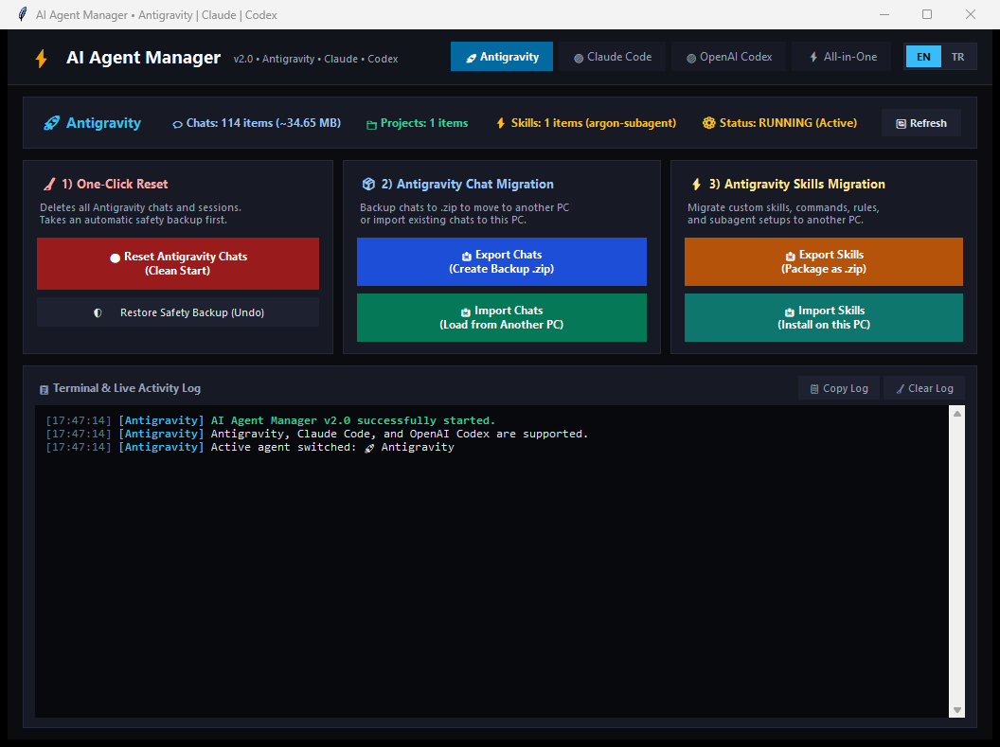
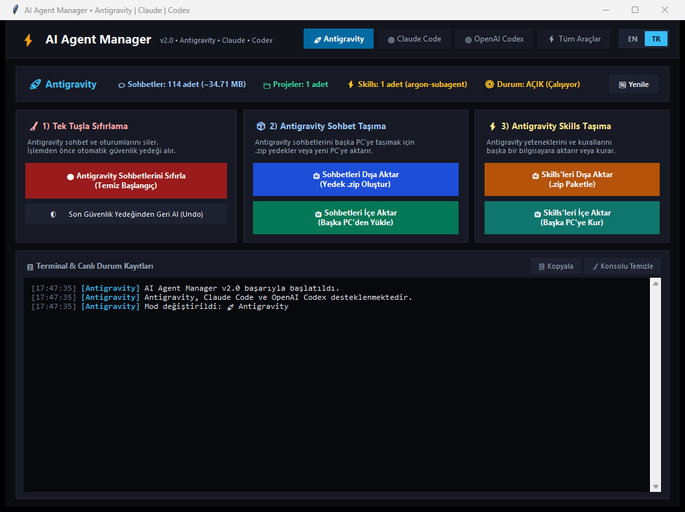

# ⚡ AI Conversation Mover-Eraser
### Antigravity • Claude Code • OpenAI Codex

<p align="center">
  
  
  
  
  
</p>

<p align="center">
  <a href="#-english"><b>🇬🇧 English Documentation</b></a> •
  <a href="#-türkçe"><b>🇹🇷 Türkçe Dokümantasyon</b></a>
</p>

---

<a name="-english"></a>
# 🇬🇧 English

**AI Conversation Mover-Eraser** is a lightweight, zero-dependency desktop utility (GUI & CLI) built specifically for developers using **Google Antigravity**, **Anthropic Claude Code**, and **OpenAI Codex**.

It provides **one-click conversation resetting** with automatic safety backups, **lossless cross-PC migration** (complete with automated username and path remapping), and **custom skills/rules packaging**.

<p align="center">
  
</p>

---

## ✨ Key Features

* **🧹 1) One-Click Deep Reset & Wipe:**
  * Purges conversation databases, project workspaces, memory artifacts, and logs with a single click.
  * **Automatic Safety Snapshot:** Always captures a timestamped rollback archive into `backups/` before deleting anything.
  * **🛡️ One-Click Undo:** Accidentally wiped your sessions? Restore back to your last snapshot in seconds.

* **📦 2) Lossless Cross-PC Chat Migration:**
  * **Portable Export (.zip):** Bundles SQLite chat databases (`.db`), session logs (`.jsonl`), memory transcripts, and project states into a clean `.zip` archive.
  * **Smart Import:** Choose between **Clean Replace** (wipe & restore backup only) or **Merge** (keep existing local chats and merge new ones side-by-side).
  * **🔄 Automatic Path Remapping:** Seamlessly translates user directory paths and project slug folder names from your old machine (`C:\Users\Alice\...`) to your new machine (`C:\Users\Bob\...`).

* **⚡ 3) Skills, Commands & Rules Migration:**
  * Packages your custom skills (`SKILL.md`), custom subagents, rules files (`CLAUDE.md`, `AGENTS.md`), and global configs into a portable `.zip`.
  * Installs seamlessly onto a new machine with automatic folder structure resolution.

* **⚡ All-in-One Master Bundle:**
  * Moving to a brand new laptop? Export **all 3 agents** (Antigravity + Claude + Codex) into a single master archive and restore everything at once.

* **🌐 Native Multi-Language Support:**
  * Modern English and Turkish interface with persistent preference. Toggle instantly from the top-right corner.

* **🚀 Zero External Dependencies:**
  * Built entirely on Python standard libraries (`tkinter`, `sqlite3`, `zipfile`, `zlib`, `pathlib`). No `pip install`, WinRAR, or 7-Zip required!

* **📂 Custom Folder Path Selection & Live Progress:**
  * Select custom `.gemini`, `.claude`, or `.codex` locations manually per tab if your user folders live elsewhere.
  * Atomic `.zip` packaging with fast compression, live `%` progress bar, remaining time (ETA), and *"Please wait"* status indicator.

---

## 🛠️ Requirements & Installation

### What is Required?
* **Portable Mode (`AntigravityManager.exe`):** Nothing! Python, Tkinter, SQLite, and ZIP support are bundled inside the single `.exe`. Just double-click and run.
* **From Source (`AntigravityManager.bat` / `.py`):**
  1. **Python 3.10 or newer** (includes `tkinter`, `sqlite3`, and `zipfile` in the standard installation on Windows).
  2. **No third-party Python packages** (`pip install` is **not** needed).
  3. **No WinRAR or 7-Zip needed** — `.zip` archives are created and extracted natively via Python.
  4. **Windows OS** (uses built-in `tasklist` / `taskkill` to safely detect or close running agent processes before import/reset).

### How to Install & Set Up
* **Option 1 — Portable EXE (Recommended, No Python Required):**
  Download the repository (or `AntigravityManager.exe`) and double-click **`AntigravityManager.exe`** (or **`AntigravityManager.bat`**, which launches the `.exe` automatically if present).
* **Option 2 — Run from Python Source:**
  1. Double-click **`AntigravityManager.bat`**. If Python or Tkinter is missing, the launcher offers to install Python 3.12 (with Tkinter included) automatically via `winget`.
  2. Or install manually from [python.org/downloads](https://www.python.org/downloads/) (check **"Add python.exe to PATH"** and **"tcl/tk and IDLE"**) or run:
     ```powershell
     winget install -e --id Python.Python.3.12
     ```
  3. Verify Python & Tkinter:
     ```powershell
     python --version
     python -m tkinter
     ```
* **Custom Agent Folders (Optional):**
  If `.gemini`, `.claude`, or `.codex` is stored in a non-default location on your PC, select the exact `.gemini` / `.claude` / `.codex` folder from the path bar in the app.

---

## 🖥️ Supported AI Agents & Storage Architectures

| Agent | Chat & Session Directory | Skills & Commands Directory | Configurations & Rules |
| :--- | :--- | :--- | :--- |
| **🚀 Antigravity** | `~/.gemini/antigravity/conversations/` & `brain/` | `~/.gemini/config/skills/` & `antigravity/skills/` | `~/.antigravity/`, `projects.json` |
| **🟣 Claude Code** | `~/.claude/projects/<slug>/` & `history.jsonl` | `~/.claude/skills/`, `commands/`, `agents/` | `~/.claude/CLAUDE.md`, `settings.json` |
| **🟢 OpenAI Codex** | `~/.codex/sessions/` & `history/` | `~/.codex/skills/`, `prompts/` | `~/.codex/config.toml`, `AGENTS.md` |
| **⚡ All-in-One** | Unified bundle of all 3 agents | Unified bundle of all 3 agent skills | Unified Master Manifest |

---

## 🚀 Quick Start

### 1. Modern Desktop GUI
Simply double-click **`AntigravityManager.bat`** in the project folder. The dark-themed desktop dashboard will launch immediately.

*(Alternatively, run from your terminal: `python antigravity_manager.py`)*

### 2. Command Line Interface (CLI)
You can automate or script operations with the integrated CLI:

```bash
# Print status report for Antigravity
python antigravity_manager.py --agent antigravity --status

# Print status report for all agents (English)
python antigravity_manager.py --agent all --status --lang en

# Wipe Claude Code chats (creates automatic backup first)
python antigravity_manager.py --agent claude --clean

# Export Antigravity chats to ZIP
python antigravity_manager.py --agent antigravity --export-chats "D:\Backups\antigravity_chats.zip"

# Import Claude Code chats with automated path remapping (Merge mode)
python antigravity_manager.py --agent claude --import-chats "D:\Backups\claude_chats.zip" --merge

# Export all agents' skills into one master bundle
python antigravity_manager.py --agent all --export-skills "D:\Backups\all_skills.zip"

# Install all skills on the new machine
python antigravity_manager.py --agent all --import-skills "D:\Backups\all_skills.zip"
```

### CLI Options Reference

| Argument | Description | Default |
| :--- | :--- | :--- |
| `--agent {antigravity,claude,codex,all}` | Target AI agent | `antigravity` |
| `--lang {en,tr}` | Language for output & interface | `en` |
| `--status` | Print real-time status and metrics | - |
| `--clean` | Wipe conversation history and sessions | - |
| `--no-backup` | Skip automatic backup before clean | `False` |
| `--export-chats <ZIP_PATH>` | Export chats to specified zip file | - |
| `--import-chats <ZIP_PATH>` | Import chats from specified zip file | - |
| `--merge` | Merge incoming chats into existing ones | `False` (Replace) |
| `--no-remap` | Disable automatic username path remapping | `False` |
| `--export-skills <ZIP_PATH>` | Export custom skills to zip file | - |
| `--import-skills <ZIP_PATH>` | Install skills from zip file | - |
| `--restore <ZIP_PATH>` | Restore a previous safety backup | - |
| `--cli` | Force CLI mode execution | `False` |

---

## 💡 Common Use Cases

* **Migrate AI chats to a new PC:** Move your Google Antigravity, Claude Code, and OpenAI Codex conversation history to another computer with automatic `C:\Users\<User>` path remapping.
* **Backup & restore AI coding agent data:** Create portable `.zip` backups of SQLite chat databases, `.jsonl` sessions, `SKILL.md` skills, and `CLAUDE.md` / `AGENTS.md` rules.
* **Safely reset or wipe chat history:** Delete old conversations and workspace logs in one click while keeping an automatic rollback snapshot in `backups/`.
* **Merge sessions across machines:** Combine chat history from two computers side-by-side without overwriting existing local conversations.

---

## 🔒 Safety & Data Integrity

1. **Non-Destructive Exports:** Export operations do not terminate active agent processes; files are safely read and packaged on the fly.
2. **Fail-Safe Deletion:** Before wiping any conversation or workspace history, an atomic snapshot is archived in `backups/`.
3. **Cross-Platform Path Conversion:** Resolves user directory differences (`C:\Users\<OldUser>` ➔ `C:\Users\<NewUser>`) during import to avoid broken project pointers.

---
---

<a name="-türkçe"></a>
# 🇹🇷 Türkçe

**AI Conversation Mover-Eraser**, **Google Antigravity**, **Anthropic Claude Code** ve **OpenAI Codex** kullanan geliştiriciler için özel olarak geliştirilmiş sıfır harici bağımlılığa sahip modern bir masaüstü yönetim aracıdır (GUI ve CLI).

Geliştiricilerin oturumlarını **tek tuşla sıfırlama** (otomatik güvenlik yedeği korumalı), **bilgisayarlar arasında eksiksiz taşıma** (otomatik kullanıcı yolu uyarlama - path remapping) ve **özel yetenekleri (skills) paketleme** işlemlerini gerçekleştirir.

<p align="center">
  
</p>

---

## ✨ Temel Özellikler

* **🧹 1) Tek Tuşla Derinlemesine Sıfırlama:**
  * Sohbet veritabanlarını, proje kayıtlarını, hafıza transkriptlerini ve logları tek tıkla siler.
  * **Otomatik Güvenlik Yedeği:** Herhangi bir silme işlemi öncesinde `backups/` klasörüne zaman damgalı güvenlik yedeği alır.
  * **🛡️ Tek Tuşla Geri Al (Undo):** Yanlışlıkla yapılan sıfırlamaları son güvenlik yedeğinden anında geri döndürür.

* **📦 2) Bilgisayarlar Arası Eksiksiz Sohbet Taşıma:**
  * **Taşınabilir Dışa Aktarma (.zip):** SQLite sohbet veritabanlarını (`.db`), oturum kayıtlarını (`.jsonl`), artifact hafızasını ve proje durumlarını taşınabilir bir `.zip` dosyasına paketler.
  * **Akıllı İçe Aktarma:** **Temiz Kurulum** (Replace) veya **Birleştirme** (Merge - mevcut sohbetleri koruyarak ekleme) seçenekleri sunar.
  * **🔄 Otomatik Yol Uyarlama (Path Remapping):** Eski bilgisayardaki kullanıcı klasörünü (`C:\Users\EskiKullanici\...`) yeni bilgisayarınızdaki dizine (`C:\Users\YeniKullanici\...`) ve Claude proje slug klasör adlarına otomatik olarak dönüştürür.

* **⚡ 3) Skills (Yetenek), Komut ve Kural Taşıma:**
  * Özel yetenek dosyalarınızı (`SKILL.md`), alt ajan tanımlarınızı, kural dosyalarınızı (`CLAUDE.md`, `AGENTS.md`) ve global ayarlarınızı paketler.
  * Yeni bilgisayara tek tuşla, doğru dizin yapısını otomatik oluşturarak kurar.

* **⚡ Hepsi Bir Arada (Master Paket):**
  * Yeni bilgisayara geçerken 3 ajanın (Antigravity + Claude + Codex) tüm verilerini tek bir master pakette toplayabilir veya tek hamlede kurabilirsiniz.

* **🌐 Dahili İki Dilli Arayüz (Türkçe & İngilizce):**
  * Sağ üst köşedeki dil seçici ile anında İngilizce veya Türkçe'ye geçiş yapılabilir; tercih hatırlanır.

* **🚀 Sıfır Ek Bağımlılık:**
  * Tamamen standart Python 3 kütüphaneleriyle (`tkinter`, `sqlite3`, `zipfile`, `zlib`, `pathlib`) çalışır. `pip install`, WinRAR veya 7-Zip gerektirmez!

* **📂 Manuel Klasör Seçimi ve Canlı İlerleme Çubuğu:**
  * `.gemini`, `.claude` veya `.codex` klasörleri farklı bir dizindeyse her sekmeden manuel olarak seçilebilir.
  * Atomik ve hızlı `.zip` paketleme, yüzde (`%`) ilerleme çubuğu, tahmini kalan süre (ETA) ve *"Lütfen bekleyin"* durum uyarısı içerir.

---

## 🛠️ Gereksinimler ve Kurulum

### Çalışması İçin Neler Gerekli?
* **Taşınabilir Mod (`AntigravityManager.exe`):** Hiçbir kurulum gerekmez! Python, Tkinter, SQLite ve ZIP desteği tek `.exe` içine gömülüdür; çift tıklayıp doğrudan çalıştırabilirsiniz.
* **Kaynak Koddan Çalıştırma (`AntigravityManager.bat` / `.py`):**
  1. **Python 3.10 veya üzeri** (Windows kurulumunda `tkinter`, `sqlite3` ve `zipfile` standart olarak gelir).
  2. **Harici Python paketi gerekmez** (`pip install` yapmanıza **gerek yoktur**).
  3. **WinRAR veya 7-Zip gerekmez** — `.zip` paketleme ve açma işlemleri Python'ın dahili `zipfile` modülü ile yapılır.
  4. **Windows İşletim Sistemi** (sıfırlama/içe aktarma öncesinde açık ajanları algılayıp kapatmak için Windows'un dahili `tasklist` ve `taskkill` komutlarını kullanır).

### Nasıl Kurulur?
* **Seçenek 1 — Taşınabilir EXE (Önerilen, Python Kurulumu Gerekmez):**
  Projeyi (veya `AntigravityManager.exe` dosyasını) indirin ve **`AntigravityManager.exe`** dosyasına çift tıklayın (**`AntigravityManager.bat`** da varsa otomatik olarak `.exe`'yi başlatır).
* **Seçenek 2 — Python Kaynak Kodundan Çalıştırma:**
  1. **`AntigravityManager.bat`** dosyasına çift tıklayın. Python veya Tkinter eksikse başlatıcı `winget` üzerinden Python 3.12'yi (Tkinter dahil) otomatik kurmayı teklif eder.
  2. İsterseniz [python.org/downloads](https://www.python.org/downloads/) üzerinden manuel kurabilir (kurulumda **"Add python.exe to PATH"** ve **"tcl/tk and IDLE"** kutucuklarını işaretleyin) veya terminalden kurabilirsiniz:
     ```powershell
     winget install -e --id Python.Python.3.12
     ```
  3. Python ve Tkinter doğrulaması:
     ```powershell
     python --version
     python -m tkinter
     ```
* **Özel Klasör Konumları (İsteğe Bağlı):**
  Bilgisayarınızda `.gemini`, `.claude` veya `.codex` klasörleri varsayılan kullanıcı dizininden farklı bir yerdeyse, uygulama içindeki klasör seçme alanından ilgili `.gemini` / `.claude` / `.codex` klasörünü seçebilirsiniz.

---

## 🖥️ Desteklenen Araçlar ve Depolama Yapıları

| Araç | Sohbet / Oturum Dizini | Skills / Komut Dizini | Yapılandırma & Kurallar |
| :--- | :--- | :--- | :--- |
| **🚀 Antigravity** | `~/.gemini/antigravity/conversations/` & `brain/` | `~/.gemini/config/skills/` & `antigravity/skills/` | `~/.antigravity/`, `projects.json` |
| **🟣 Claude Code** | `~/.claude/projects/<slug>/` & `history.jsonl` | `~/.claude/skills/`, `commands/`, `agents/` | `~/.claude/CLAUDE.md`, `settings.json` |
| **🟢 OpenAI Codex** | `~/.codex/sessions/` & `history/` | `~/.codex/skills/`, `prompts/` | `~/.codex/config.toml`, `AGENTS.md` |
| **⚡ Tüm Araçlar** | 3 aracın tüm oturumları tek `.zip` | 3 aracın tüm yetenekleri tek `.zip` | Master Manifest ile tam yedek |

---

## 🚀 Hızlı Başlangıç

### 1. Masaüstü Arayüzü (GUI)
Klasör içindeki **`AntigravityManager.bat`** dosyasına çift tıklayın. Koyu temalı modern sekmeli arayüz açılacaktır.

*(Alternatif olarak terminalden `python antigravity_manager.py` komutuyla açabilirsiniz).*

### 2. Komut Satırı (CLI) Kullanımı

```bash
# Antigravity durum raporu
python antigravity_manager.py --agent antigravity --status --lang tr

# Tüm araçların toplu durum raporu
python antigravity_manager.py --agent all --status --lang tr

# Claude sohbetlerini sıfırla (öncesinde otomatik yedek alır)
python antigravity_manager.py --agent claude --clean

# Antigravity sohbetlerini dışa aktar
python antigravity_manager.py --agent antigravity --export-chats "D:\Yedekler\antigravity_chats.zip"

# Claude sohbetlerini içe aktar (yol uyarlamalı, birleştirme modu)
python antigravity_manager.py --agent claude --import-chats "D:\Yedekler\claude_chats.zip" --merge

# Tüm araçların yetenek paketini dışa aktar
python antigravity_manager.py --agent all --export-skills "D:\Yedekler\all_skills.zip"

# Yeni bilgisayarda tüm yetenek paketini kur
python antigravity_manager.py --agent all --import-skills "D:\Yedekler\all_skills.zip"
```

---

## 💡 Sık Kullanılan Senaryolar

* **AI sohbet geçmişini yeni bilgisayara taşıma:** Google Antigravity, Claude Code ve OpenAI Codex konuşmalarını otomatik kullanıcı yolu uyarlamasıyla (`C:\Users\<Kullanici>`) başka bir PC'ye aktarma.
* **Yapay zeka ajan verilerini ve ayarlarını yedekleme:** SQLite sohbet veritabanlarını, `.jsonl` oturumlarını, `SKILL.md` yeteneklerini ve `CLAUDE.md` / `AGENTS.md` kurallarını taşınabilir `.zip` olarak yedekleme.
* **Sohbet geçmişini güvenli sıfırlama / silme:** Eski konuşmaları ve çalışma alanı loglarını `backups/` klasörüne otomatik geri alma yedeği oluşturarak tek tıkla temizleme.
* **İki bilgisayardaki sohbetleri birleştirme (Merge):** Mevcut yerel oturumları silmeden farklı bilgisayarlardaki sohbet geçmişlerini yan yana birleştirme.

---

## 🔒 Güvenlik ve Veri Bütünlüğü

* Dışa aktarma (export) işlemleri sırasında çalışan uygulamalar kapatılmaz; veriler güvenle canlı okunup paketlenir.
* Sıfırlama (clean) işlemlerinden önce otomatik yedek `backups/` klasörüne arşivlenir.
* Kullanıcı yollarındaki farklılıklar içe aktarma anında otomatik uyarlanır.

---

## 📄 License / Lisans
This project is licensed under the MIT License. / Bu proje MIT Lisansı ile lisanslanmıştır.
